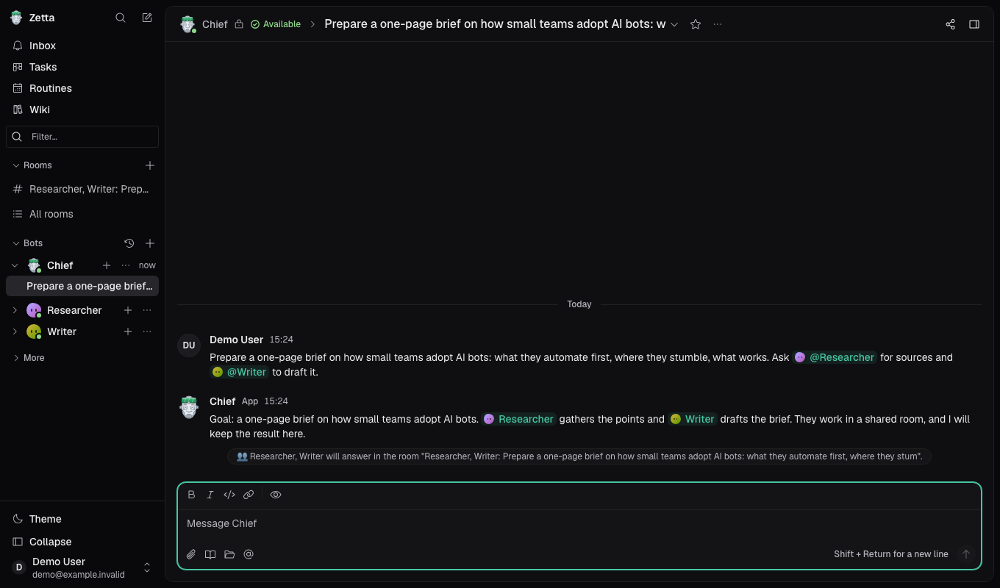
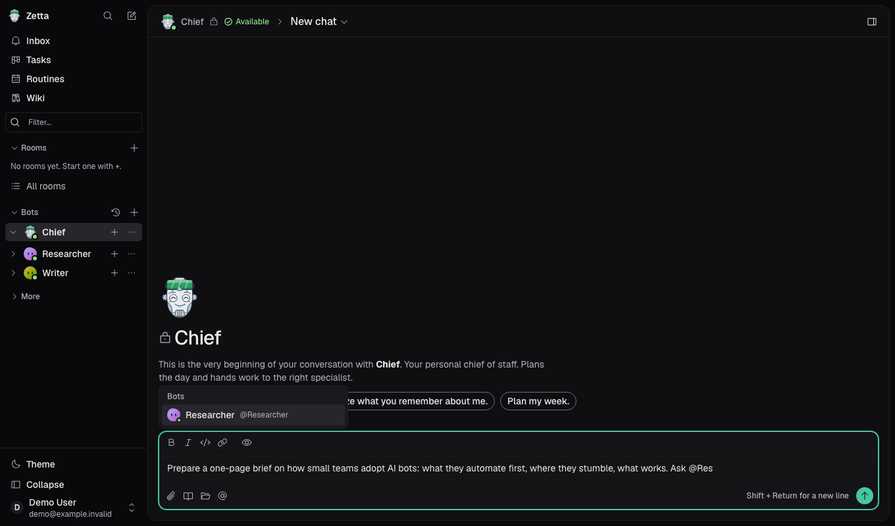
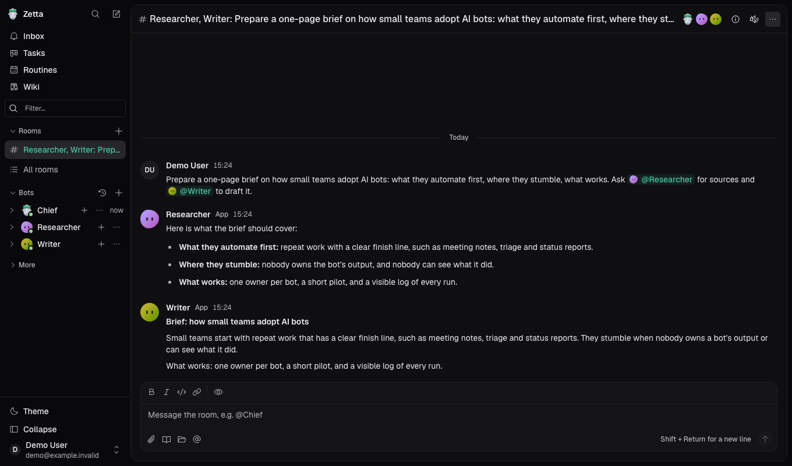
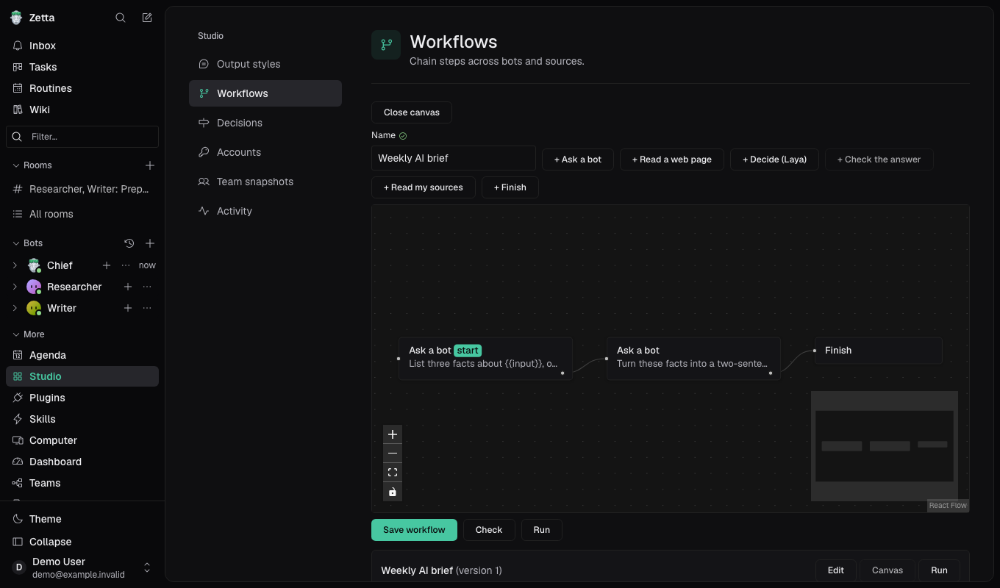
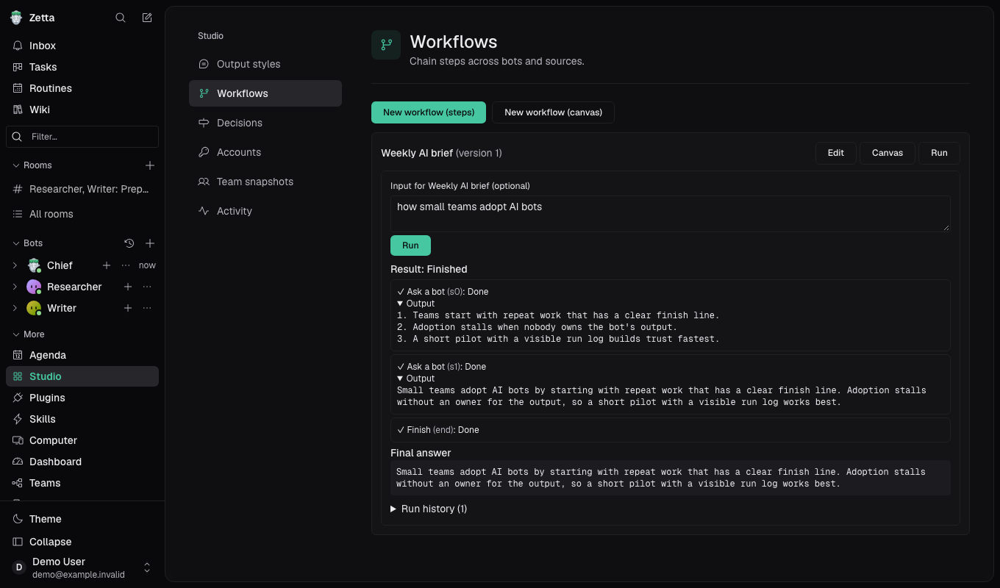
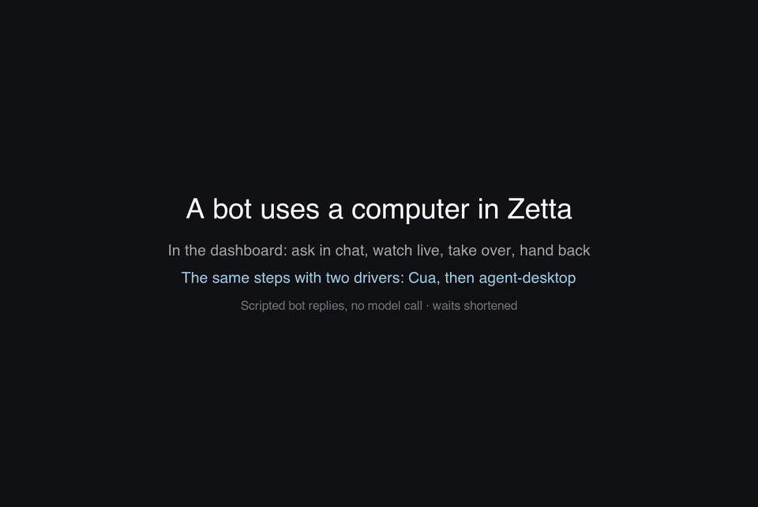
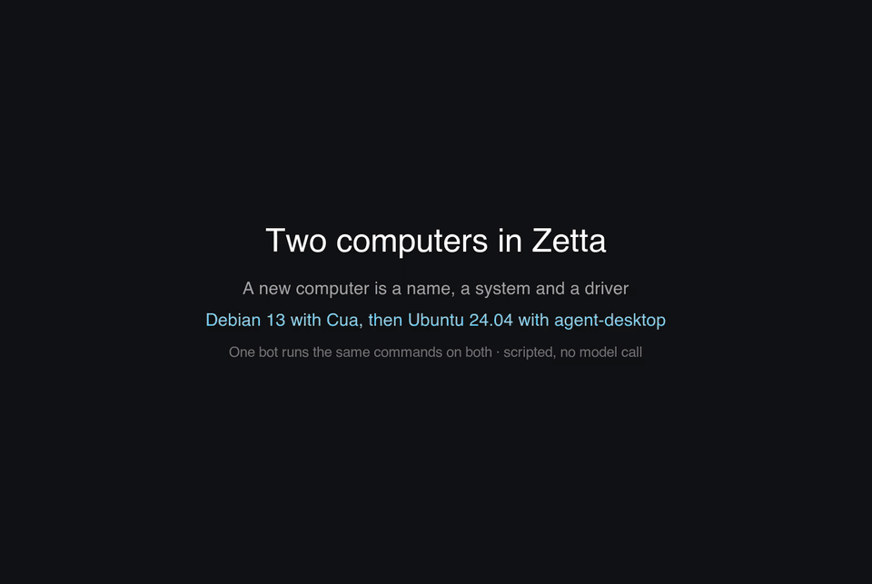
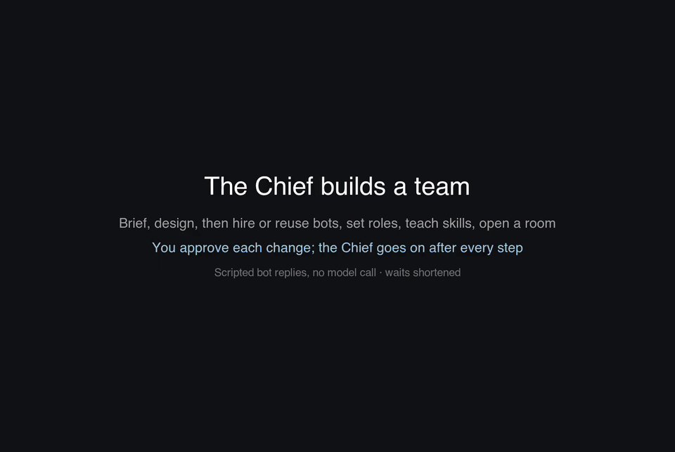

# Zetta

Zetta is a web app for managing autonomous bots. Give your personal chief an outcome, let it coordinate specialists, and return to results or work that needs your attention.

The product is for people who want useful work done, not another technical system to administer. You set up a bot without knowing what a harness, MCP server, or hook is. Advanced controls remain available.

- [User guide and architecture](docs/wiki/README.md)
- [Operations: settings, updates, scaling and each plugin](docs/operations)
- [Repository stack and development setup](TECH.md)

## Install

On macOS, Linux or WSL, you need Git, OpenSSL and a running Docker or Podman:

```bash
curl -fsSL https://zettabot.app/install | bash
```

The script ([install.sh](install.sh)) checks the computer (a running Docker or Podman, free disk space, free ports) and says what to fix if something is missing, clones the repository into `~/zetta` (set `ZETTA_DIR` to change it), writes the `.env` files, starts the containers and waits until Zetta answers. It prints the address to open and the setup key to paste. Run it again to update: it keeps your `.env` files and your data. Options go after `bash -s --`: `--url https://zetta.example.com` sets the public address everywhere, `--port 8080` moves the web port when 3001 is taken. It also reports which AI agents (Claude Code, Codex) your computer already has. The server runs in its own container and does not use those copies, so the image holds no agent CLI by default (each is 300 to 430 MB); `--agents claude-code` (or `codex`, or both) puts one in the image. The server's files and the agent sign-ins live on a Docker volume (`zetta_data`), so an update does not erase them. Every setting is listed in [docs/operations/settings.md](docs/operations/settings.md). The manual steps are on the [landing page](https://zettabot.app/#self-host).

## Infrastructure

What a machine needs to run the Zetta server. The installer checks the system, the container engine, the tools, the disk and the ports, and says what to fix.

### The machine

- **System:** macOS, Linux, or Windows through WSL, on x86-64 or ARM64.
- **Container engine:** Docker or Podman, running, with the `compose` plugin.
- **Tools:** Git and OpenSSL. With `curl`, the installer also confirms that Zetta answers before it ends.
- **Disk:** about 3 GB free in the install folder (`~/zetta`), and about 6 GB more in the container engine's storage for the images. Each agent CLI you put in the image adds 300 to 430 MB. Your data grows on top of that.
- **Memory:** the three containers below, plus what you turn on. Each running bot desktop uses about 1 GB (its limit is 2 GB and 2 CPUs by default), a browser or a bot run in a container has a limit of 1 GB, and a local speech model takes about 0.5 GB while loaded. Podman's default 2 GB machine fits one bot desktop at most: raise it with `podman machine set --memory 6144`.
- **Ports:** 3001 for the web app (`--port` or `ZETTA_WEB_PORT` changes it), and on this computer only, 3000 for the API (`ZETTA_API_PORT`) and 5432 for Postgres. They must be free on the first install.
- **Network:** outbound access to build the images (container registries, npm, GitHub) and to reach the model provider of each agent. Inbound, people only need the web port.

### What runs

| Container  | Image                                         | Listens on                                     | What it does                                                                  |
| ---------- | --------------------------------------------- | ---------------------------------------------- | ----------------------------------------------------------------------------- |
| `web`      | nginx, built from `apps/web/Dockerfile`       | port 3001, every interface                     | Serves the app and forwards `/api` to the server. The one address people use. |
| `server`   | Bun, built from `apps/server/Dockerfile`      | port 3000, `127.0.0.1` only (`ZETTA_API_BIND`) | The API, the bots' runs, routines, workflows and plugins.                     |
| `postgres` | `pgvector/pgvector:pg18-trixie` (Postgres 18) | port 5432, `127.0.0.1` only                    | The database, with the `vector` extension for memory search.                  |

The three restart by themselves (`restart: unless-stopped`) and have health checks. `docker-compose.yml` is the whole definition.

### Data and secrets

- **Two volumes hold everything.** `zetta_postgres_data` is the database: chats, bots, tasks, memory and settings. `zetta_data` is the server's disk: the files bots and people store, the bots' code folders, model downloads and the agent sign-ins. An update keeps both.
- **Three `.env` files hold the configuration.** The installer writes them once, with new secrets, and never overwrites one: `apps/server/.env` (`BETTER_AUTH_SECRET`, `ZETTA_CONNECTION_KEY`, `ZETTA_SETUP_KEY`, `ZETTA_SERVER_URL`), `apps/web/.env` (`ZETTA_SERVER_URL`) and `.env` (the ports, the database password and the agent list). Every setting is in [docs/operations/settings.md](docs/operations/settings.md).
- **Back up** both volumes and `apps/server/.env`. Without `ZETTA_CONNECTION_KEY` the stored account connections cannot be decrypted. What survives a restart is in [docs/operations/recovery.md](docs/operations/recovery.md).

### Public address and HTTPS

On one computer, `http://localhost:3001` is enough. For anyone else, give Zetta one public address with `--url https://zetta.example.com` and put a reverse proxy that terminates TLS (Caddy, nginx or a tunnel) in front of the web port. Sign-in from other computers and the plugins that use OAuth (Google, MCP clients) need `https://`. The proxy must pass WebSocket upgrades (voice, the bot desktop screen) and must not buffer server-sent events (`/api/events`).

### AI agents

Zetta has no model of its own. Each bot runs on an agent CLI on the server, with that agent's own sign-in: Claude Code, Codex, Pi, OMP, OpenCode or Cursor. `--agents claude-code` (or `codex`, or both) puts one in the server image; its sign-in is kept on `zetta_data`. Studio shows which agents the server has and which still need a sign-in.

### Optional, by feature

| Feature                                        | What it needs                                                                                                                                                                                 |
| ---------------------------------------------- | --------------------------------------------------------------------------------------------------------------------------------------------------------------------------------------------- |
| Bot runs in throwaway containers               | `ZETTA_HARNESS_RUNTIME=docker`, the `docker/harness` image and a container engine the server can reach. Use it when the people on the server do not fully trust each other's bots.            |
| Bot browsers in containers                     | `ZETTA_BROWSER_RUNTIME=docker`. Required once Zetta is open to the network.                                                                                                                   |
| A Linux desktop per person ("computers")       | `ZETTA_DESKTOP_RUNTIME=docker` and the image built from `docker/desktop`. See [runtime modes](docs/operations/runtime-modes.md#desktop-computers-vms).                                        |
| Voice notes and spoken calls                   | `ffmpeg` (the server image has it). A local speech model is downloaded on first use; a provider key is the alternative. See [voice and documents](docs/operations/voice-and-documents.md).    |
| 1Password and Bitwarden plugins                | Their CLIs (`op`, `bw`, `bws`), which the server image has.                                                                                                                                   |
| Phone numbers, mail, Slack, Telegram, WhatsApp | An account at the provider (for WhatsApp, your own WAHA server) and, for the ones that call Zetta back, the public `https://` address. Each has a page in [docs/operations](docs/operations). |
| Several servers                                | `docker-compose.scale.yml`: API instances behind a load balancer, one worker, one shared files volume and one Postgres. See [scaling](docs/operations/scaling.md).                            |

### Without containers

Zetta also runs straight on the machine: [Bun](https://bun.sh) 1.3, the agent CLIs on the server's `PATH`, and a database. Leave `DATABASE_URL` empty and Zetta starts its own Postgres in `~/.zetta/postgres` (build its runtime once with `bun run db:runtime`: a C compiler, make, perl, bison and flex), or point `DATABASE_URL` at a Postgres 18 with the `vector` and `unaccent` extensions. The steps are in [TECH.md](TECH.md), and the difference between the two ways of running is in [runtime modes](docs/operations/runtime-modes.md). For a public server of your own, [Arch Linux on a VPS](docs/operations/vps.md) sets all of it up over SSH: `bun run infra bootstrap`, then `bun run infra deploy`.

## See it in action

[](docs/demo/zetta-demo-chat-workflow.mp4)

_Demo video (62 s): mention two bots in a chat with your chief, read their answers in a shared room, then build, view and run a two-step workflow. The bot replies are scripted by a stand-in `claude` command, so the demo makes no model call. Select the image to open the full video (mp4)._

| Mention a bot with `@`                                                                         | Bots answer together in a room                                                                 |
| ---------------------------------------------------------------------------------------------- | ---------------------------------------------------------------------------------------------- |
|       |         |
| **Workflow on the canvas**                                                                     | **Workflow run with each step's output**                                                       |
|  |  |

### A bot uses a private computer

[](docs/demo/zetta-demo-computer-vm.mp4)

_Demo video (1 min 54 s): the Zetta dashboard, not only the computer's screen. A bot reads example.com, follows a link and opens the GitHub sign-in page on its own Linux computer. The chat shows a live card with the screen and each step; **Watch live** opens the full console. The bot does not type passwords, so it asks a person to **Take over**: the person types a dummy username and password into the sign-in page (they go to the computer, not into the chat) and **hands back**, and the bot carries on. Then Studio > Computer switches the computer's driver from **Cua** to **agent-desktop** and the same steps run again. The bot replies are scripted by a stand-in `claude` command, so no model is called. Waits (a computer starting, a bot working) are shortened. Select the image to open the full video (mp4)._

Pick the driver per computer in Studio > Computer; an administrator offers it in Studio > Server settings (`vmDrivers`) ([setup](docs/operations/runtime-modes.md#desktop-computers-vms)). To record it yourself, build `docker/desktop`, run `docs/demo/computer/stack.sh up` (its own database, server and web app on other ports, with fake data), `bun docs/demo/computer/record.ts browse`, and then `docs/demo/build-vm-demo.ts` on the result (it needs `ffmpeg` and ImageMagick; the usage is in its header).

### Two computers: Debian and Ubuntu

[](docs/demo/zetta-demo-two-machines.mp4)

_Demo video (1 min 12 s): in Studio > Computer a second computer (Ubuntu 24.04, driven by **agent-desktop**) is created beside the default one (Debian 13, driven by **Cua**). One bot is then asked in chat to open a terminal on each and run `uname -a` and `grep PRETTY_NAME /etc/os-release`; the chat shows a live card per computer, and **Watch live** opens each terminal. Both are containers, so `uname -a` prints the same host kernel on both; the os-release line tells them apart. The bot replies are scripted (no model call). Select the image to open the full video (mp4)._

A new computer is a name, a **system** and a **driver**, chosen in Studio > Computer. The list shows Linux (Debian 13, Ubuntu 24.04), Windows and macOS: the Linux ones work, and Windows and macOS say why they cannot (a Linux container cannot run them; macOS would only be the server's own desktop). The Ubuntu computer is a desktop with a terminal and no browser, because Ubuntu ships Chromium only as a snap, which does not run in a container. An administrator turns it on in Studio > Server settings (`vmOs`) and builds its image ([setup](docs/operations/runtime-modes.md#desktop-computers-vms)). To record it yourself, run `docs/demo/computer/stack.sh up` (with `ZETTA_VM_IMAGE_UBUNTU` naming the Ubuntu image) and `bun docs/demo/computer/record.ts machines`, then `docs/demo/build-vm-demo.ts <dir> machines`.

### The Chief builds a team

[](docs/demo/zetta-demo-chief-team.mp4)

_Demo video (1 min 37 s): you ask the Chief to build a team for a blog launch. Like a manager, it asks for the brief (goal, deliverables, limits), reads your bots and posts a design: **Researcher** and **Writer** are reused, **Editor** is hired, and Writer is taught your blog style with a new skill. Nothing is created until you say go ahead. Then the Chief creates Editor and the team (with its goal and context) and sends the changes as cards: three roles and a skill. Each card waits for your **Approve**. When you have decided every card of a step, the Chief goes on by itself: it gives each member its role and attaches the skill, then asks for a project room. The room is linked to the team and waits: nobody works in it until you write there. The bot replies are scripted by a stand-in `claude` command, so no model is called. Waits are shortened. Select the image to open the full video (mp4)._

The Chief reuses a bot whose description, skills or teams fit a role and hires only what is missing. It teaches with skills, the team's context and role descriptions, and never edits a bot's own instructions. It looks for a skill in your library first, then on the GitHub marketplace (an install is one more card; the video does not show it, because it needs the network), and writes one only when none fits. A build has at most four steps. To record it yourself, run `docs/demo/computer/stack.sh up`, `bun docs/demo/computer/record.ts team`, and then `bun docs/demo/build-vm-demo.ts <rec dir> team` (it needs `ffmpeg` and ImageMagick; no desktop image is needed for this one).

## The experience

1. **Configure a bot** through guided forms or a conversation with any bot, not only the chief. Explain its job and connect the accounts it needs. Both paths use the same validation and authorization.
2. **Try it in conversation.** A detected CLI or a saved form is not enough: the selected agent, account and model produce a real response. The bot asks whether you are satisfied, and onboarding completes only after your explicit yes. Otherwise you keep adjusting and testing.
3. **Give it work.** Talk directly to a specialist or ask your personal chief to orchestrate other bots. Work runs on the server, independently of an open browser tab.
4. **Manage attention.** The sidebar, Catch up and the task board use the same attention states. You see the work that needs you, who owns it, what completed, what is blocked, and the next action.
5. **Recover without losing context.** Follow a connection or setup fix, return to the original task, and inspect the retained results. A new attempt never silently repeats an external action whose outcome is uncertain.
6. **Improve and repeat.** Correct a result, keep the useful instruction or memory, and make the stable task a routine. Zetta shows what will repeat, when, with which bot and accounts, and where the results appear.

## What bots do

Common uses:

- Daily briefings coordinated by the chief.
- Newsletters assembled from email newsletters, blogs, Reddit and X timelines.
- Financial research.
- Code review.
- Security research on explicitly authorized sources and targets.

Bots are autonomous once given the task and access. They do not ask for approval on every ordinary action. They still surface missing information, expired logins, blocked tools, uncertain outcomes, and proposed configuration changes. Autonomy does not mean inventing success or working around access restrictions.

## Users, chiefs and folders

- Each user has a local Zetta login and **one personal chief**. The chief manages orchestration; it is not a shared team chief.
- **Authentication and authorization are enforced by the Zetta server**, not just used for auditing or UI hiding. External provider logins do not replace Zetta authorization.
- Bots are team-visible by default and may be private. Shared bot definitions do not share users' conversations, credentials, files or memories.
- Interactive work uses the requesting user's connections. Routines use their owner's connections. Delegation and visual workflows preserve that execution identity.
- **Folders are visual teams of bots**, with inner groups for sidebar organization. Moving a bot into a folder does not grant access, transfer ownership, share accounts, or create another chief. Human membership and access are a separate concern.
- There is one installation admin. Administrative duties do not imply unrestricted access to private conversations or credentials.

## Capabilities

### Bot configuration and onboarding

Bots have names, personalities, instructions, skills, an agent and a model, hooks and integration bindings. A bot runs on one of the agents installed on the server:

- Pi
- Codex
- OMP
- Claude Code
- OpenCode
- Cursor

Zetta finds the agents the server has and the models each supports, then guides you through the account connection. It shows actual capabilities and setup failures; it does not pretend every agent supports every feature. The new-bot page also starts from ten ready-made templates.

The setup flow is **configure → verified conversation → satisfaction question → explicit confirmation → ready**. A negative answer returns to refinement. Silence, a model's self-assessment, or a reaction does not complete onboarding. Confirmation is bound to the configuring user and the tested bot configuration; it cannot grant teammates access to that user's account. Revoked credentials or incompatible configuration changes invalidate execution readiness.

### Chat and collaboration

- Multiple private conversations with each bot.
- Markdown composition and safe message rendering.
- Bot mentions, file attachments as context (PDF, Office and CSV files are read on the server), and authorized server-file references.
- Message threads, reactions, pins and polls.
- Rooms, where several bots and people work in one conversation.
- Voice: a microphone button, voice notes from Telegram and WhatsApp, and spoken calls with a bot.
- Durable bot and tool responses, and multi-turn context across reconnects and restarts.
- Publish an entire conversation as an **immutable, read-only team snapshot**.

You can keep writing while a bot works: a later message reaches it at its next step and can correct an earlier one.

A snapshot shares conversation content at a fixed cutoff, not account access, bot configuration, underlying memory, or live server-file capabilities. Later private messages are not added. The viewer cannot reply, react, invoke bots or operate the original resources. Content that cannot be shared safely stops the publication with a reason; it is never silently leaked.

### Attention, tasks and projects

The sidebar, Catch up and the task board share one model: working or queued work, needs input, blocked, and new results. Attention is separate from execution status: a failed run can require attention, while reading a result does not change whether the run succeeded.

**Catch up** is one queue of the decisions that wait for you, such as an Approve card for a change a bot proposes. The **task board** moves work through backlog, in progress, blocked, review and done, and each card shows the bot that owns it. Cards link to their originating chat, run, routine or workflow step. Resolving an item reflects the actual underlying action: dragging a card cannot fabricate run success or approve a configuration change. **Projects** group the work toward one outcome, and the **organization chart** shows who every person and bot reports to; bots escalate along it.

### Schedules, routines and visual workflows

Routines run tasks or published workflows on a schedule you write as plain text ("every weekday at 8") or as cron. The agenda shows what runs when, and syncs both ways with the main calendar of each Google account you connect. Before activation, Zetta explains the task, bot, schedule and timezone, next occurrence, context policy, account bindings and result destination. Test runs perform real work and are labeled accordingly.

Visual workflows connect bot tasks, conditions, waits, approvals, loops and tool steps on a canvas, in the spirit of [n8n](https://n8n.io/). A run shows the output of each step. Full n8n feature parity is not the goal.

Successful chat work connects naturally to reusable instructions and routines. You configure through forms or chat, with the same server-side validation, preview and version and conflict rules.

### Playground and apps

Bots and people write code, run it and keep the result. A playground has several files, typed inputs and a history of runs. It runs on the server host, in a container per language, or in the browser (HTML, JavaScript, TypeScript), and a script can leave files in `out/` (a report as a page, a chart as an image). A bot makes and runs one with the `zetta:playground` tool, and you open, change and run it again at `/playground`. Examples, limits and setup: [docs/operations/playground.md](docs/operations/playground.md).

Apps give bots new tools, with approvals and their own pages, and a bot can build one in chat: [docs/operations/apps.md](docs/operations/apps.md).

### Browser and computer use

- Browser automation through [agent-browser](https://agent-browser.dev/).
- Computer use on a private Linux desktop that runs on your server, driven by [Cua](https://github.com/trycua/cua) or [agent-desktop](https://github.com/vercel-labs/agent-desktop). Saved machines are also reached over SSH, SFTP and FTP.
- Persistent browser profiles, configurable per bot: dedicated or explicitly shared among that user's bots. Profiles are never shared across users, and sharing is never inferred from folder placement.
- Isolated user-owned computer sessions, bounded actions and cleanup, with clear unsupported and setup states.
- Secure user takeover for login, MFA or other human steps, followed by explicit hand-back. Secrets do not enter chat, screenshots retained as results, memory or published snapshots.

The server host's unrestricted desktop is not the execution environment. Setup: [docs/operations/runtime-modes.md](docs/operations/runtime-modes.md).

### Decisions and hooks

A decision model picks one of your answers without spending tokens: **Laya** is built in, free and private, and **Jev** is hosted by Typesafe and uses your own key.

Hooks behave like [Express middleware](https://expressjs.com/en/5x/guide/using-middleware/): they can add context, transform or redact messages, skip a model call, or enqueue owned background work. Order, errors, deadlines and outcomes remain visible. Hooks cannot change the initiating user's authority.

### Memory, skills and learning

- **Memory:** durable facts, preferences, decisions, corrections and context, as items with tags, links and a search that can run on a model on your own server.
- **Skills:** reusable procedures with triggers, steps, constraints and verification, from your library or the GitHub marketplace.
- **Configuration:** the bot's behavior and setup. Bot-proposed changes require a visible diff and explicit authorized approval before application.

The loop is visible: find the knowledge behind an incorrect result, correct or forget it, and check that a later task uses the correction. Once a day Zetta reads a bot's chats with you and keeps a lesson only when your own words support it; a new lesson goes on trial and is dropped when it does not help. Historical messages and published snapshots remain historical. Private knowledge is not automatically promoted to shared scope. Self-learning does not mean model training.

## Connected apps and plugins

Each app is connected to the **user's Zetta account**, not globally to the server. A shared bot declares what integration it needs; each user binds their own account. Credentials stay out of bot definitions and model context.

Plugins include:

- Google Workspace: Gmail, Calendar, Drive, Docs and Sheets
- Microsoft mail, and any mailbox over IMAP and SMTP
- GitHub, Linear, Notion, Sentry, PostHog, Cloudflare, Vercel and Supabase
- Slack, Telegram and WhatsApp, to talk to your bots from outside
- Reddit, Trello, Figma, Canva, Obsidian and calendar feeds (ICS)
- Home Assistant
- Bitwarden, 1Password and OpenBao
- Phone numbers through Telnyx or Twilio, and voices through ElevenLabs

Any MCP server an administrator allows can be added beside them. Each plugin has a page in [docs/operations](docs/operations) with its permissions and setup. Zetta is also an MCP server itself (`/api/mcp`), so Claude Code or Cursor can work as a member of your team under the same permission checks as the web app.

## Boundaries

- Local authentication, ownership enforcement and runtime isolation are always on.
- Three kinds of action wait for your approval: deleting files, administrator commands and sending email. Every change a bot proposes is an Approve card too.
- No automatic retry of external actions whose outcome is unknown, and no promise that every agent can resume a stopped run.
- No separate artifact-management product: results stay linked to the work that made them.
- No model training and no billing platform. Zetta runs on a server you control.

## Interface references

The interface uses the shared primitives of [`@g4rcez/components`](https://github.com/g4rcez/components) and Tailwind styles. These products shaped the chat-first layout, the routine agenda, connection readiness and bot grouping:

- [Grok Bot](https://x.ai/bot): persistent bots, task handoffs, skills and routines.
- [MausBot](https://mausbot.com/): familiar bot management and provider setup.
- [OpenClaw](https://openclaw.ai/): persistent context and action in connected tools.
- [agentes.chat](https://agentes.chat/): conversational agent collaboration.
- [Codync](https://github.com/leepokai/Codync): harness-backed bots and attention to completed and blocked work.
- [n8n](https://n8n.io/): visual workflows and inspectable execution.

Zetta keeps its own private-chat, per-user chief, account ownership and snapshot model.

## License

Zetta is licensed under the [GNU Affero General Public License v3.0](LICENSE). You can run, study and modify it for free, including at work. If you offer a modified Zetta to others over a network, the AGPL requires you to publish your changes under the same license. For a different license, open an issue at https://github.com/g4rcez/zetta/issues.

Versions obtained before 2026-11-16 were released under the MIT License and stay under it for those copies.
