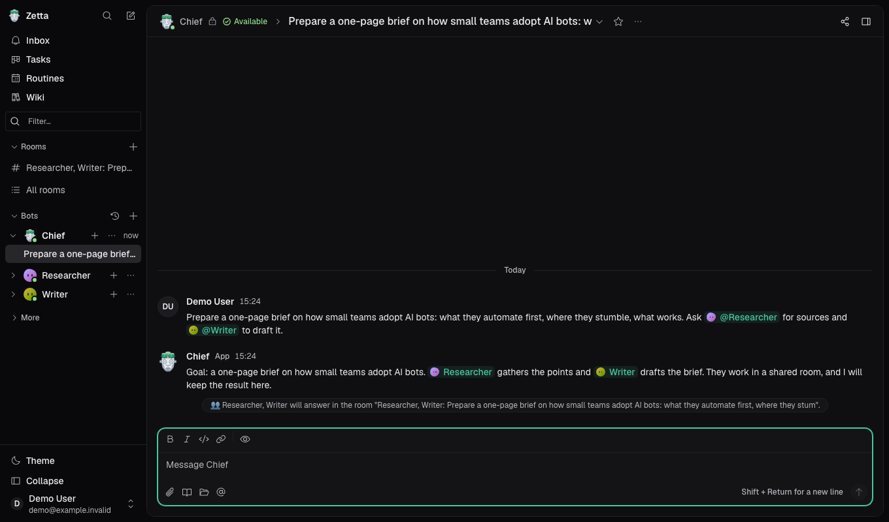
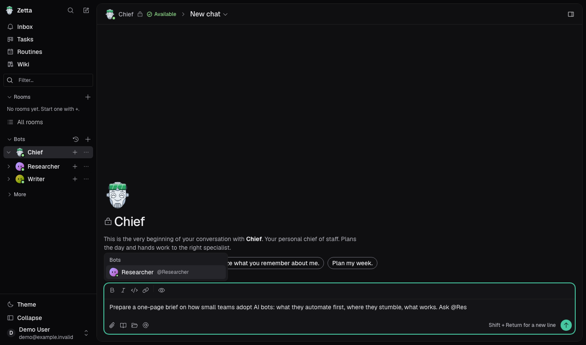
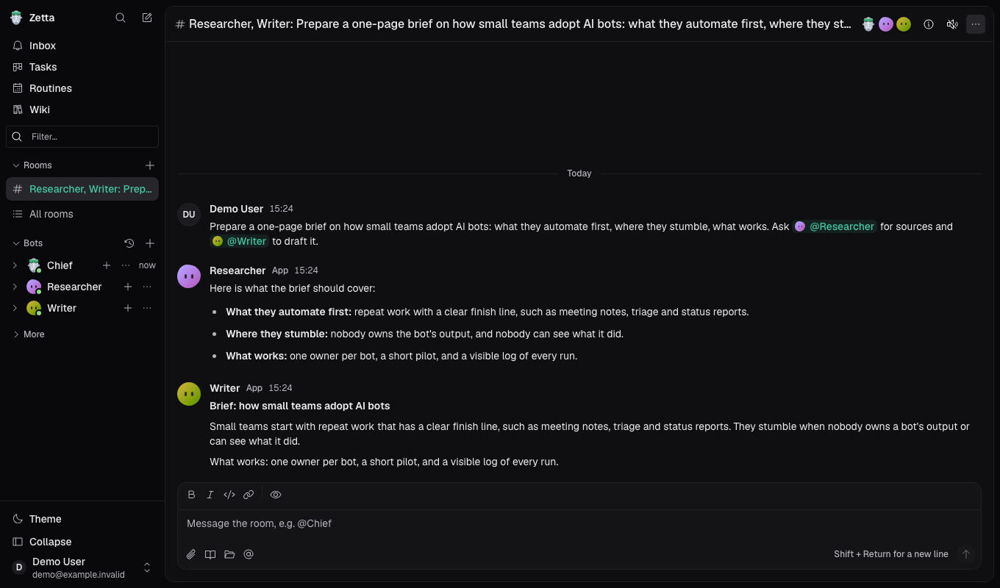
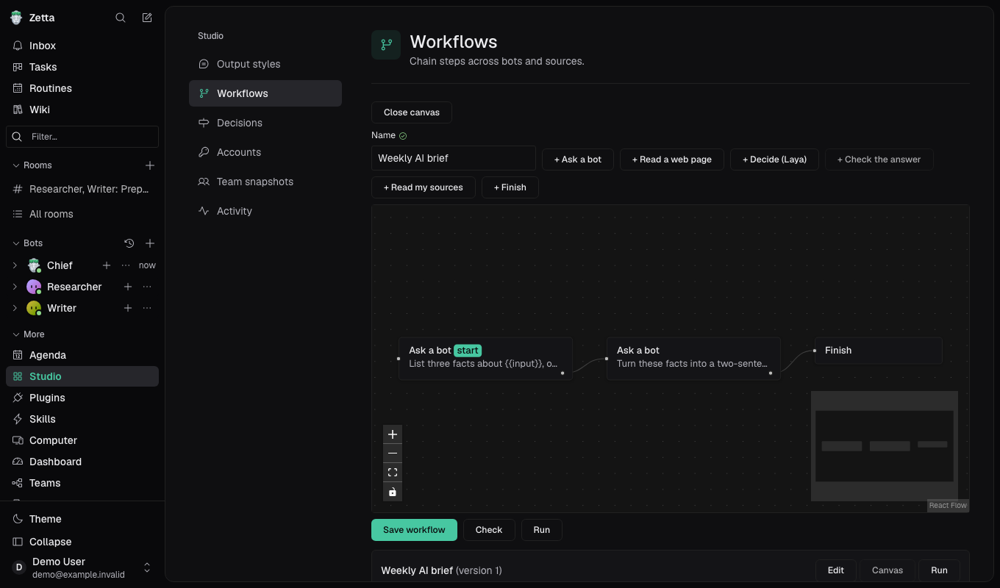
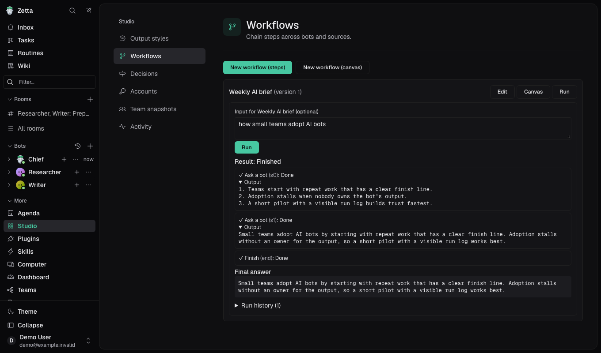
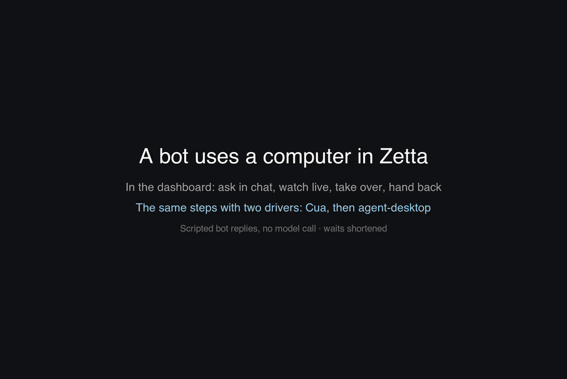
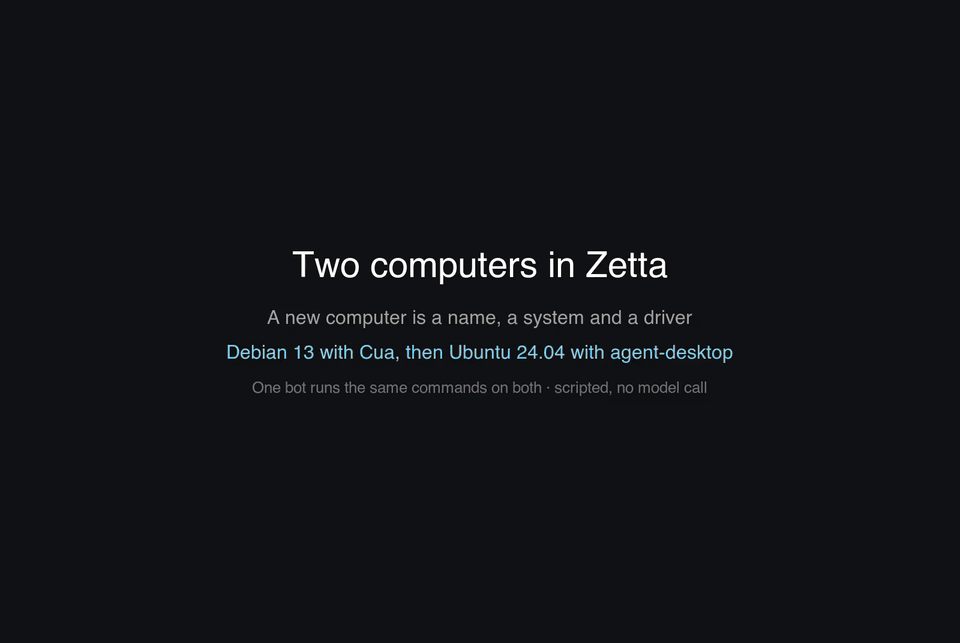

# Zetta

Zetta is a web app for managing autonomous bots. Give your personal chief an outcome, let it coordinate specialists, and return to results or work that needs your attention.

The product is for people who want useful work done, not another technical system to administer. Configuration must be understandable without knowing what a harness, MCP server, or hook is. Advanced controls remain available.

**Status:** product definition and RFC backlog. The capabilities below describe the intended v1, not features already implemented.

- [Wiki: user journeys, architecture, and product assumptions](docs/wiki/README.md)
- [Confirmed product intent](docs/intent/zetta-v1.md)
- [Implementation plan](tasks/plan.md)
- [Ordered RFC backlog](TASKS.md)
- [Small-model task execution rules](tasks/README.md)
- [Repository stack and development setup](TECH.md)

## See it in action

_Demo video (62 s): mention two bots in a chat with your chief, read their answers in a shared room, then build, view and run a two-step workflow. The bot replies are scripted by a stand-in `claude` command, so the demo makes no model call. Select the image to open the full video (mp4)._

| Mention a bot with `@`                                                                         | Bots answer together in a room                                                                 |
| ---------------------------------------------------------------------------------------------- | ---------------------------------------------------------------------------------------------- |
|       |         |
| **Workflow on the canvas**                                                                     | **Workflow run with each step's output**                                                       |
|  |  |

### A bot uses a private computer

_Demo video (1 min 54 s): the Zetta dashboard, not only the computer's screen. A bot reads example.com, follows a link and opens the GitHub sign-in page on its own Linux computer. The chat shows a live card with the screen and each step; **Watch live** opens the full console. The bot does not type passwords, so it asks a person to **Take over**: the person types a dummy username and password into the sign-in page (they go to the computer, not into the chat) and **hands back**, and the bot carries on. Then Studio > Computer switches the computer's driver from **Cua** to **agent-desktop** and the same steps run again. The bot replies are scripted by a stand-in `claude` command, so no model is called. Waits (a computer starting, a bot working) are shortened. Select the image to open the full video (mp4)._

Pick the driver per computer in Studio > Computer; the operator offers it with `ZETTA_VM_DRIVERS=cua,agent-desktop` ([setup](docs/operations/runtime-modes.md#desktop-computers-vms)). To record it yourself, build `docker/desktop`, run `docs/demo/computer/stack.sh up` (its own database, server and web app on other ports, with fake data), `bun docs/demo/computer/record.ts browse`, and then `docs/demo/build-vm-demo.ts` on the result (it needs `ffmpeg` and ImageMagick; the usage is in its header).

### Two computers: Debian and Ubuntu

_Demo video (1 min 12 s): in Studio > Computer a second computer (Ubuntu 24.04, driven by **agent-desktop**) is created beside the default one (Debian 13, driven by **Cua**). One bot is then asked in chat to open a terminal on each and run `uname -a` and `grep PRETTY_NAME /etc/os-release`; the chat shows a live card per computer, and **Watch live** opens each terminal. Both are containers, so `uname -a` prints the same host kernel on both; the os-release line tells them apart. The bot replies are scripted (no model call). Select the image to open the full video (mp4)._

A new computer is a name, a **system** and a **driver**, chosen in Studio > Computer. The list shows Linux (Debian 13, Ubuntu 24.04), Windows and macOS: the Linux ones work, and Windows and macOS say why they cannot (a Linux container cannot run them; macOS would only be the server's own desktop). The Ubuntu computer is a desktop with a terminal and no browser, because Ubuntu ships Chromium only as a snap, which does not run in a container. The operator turns it on with `ZETTA_VM_OS=debian,ubuntu` and builds its image ([setup](docs/operations/runtime-modes.md#desktop-computers-vms)). To record it yourself, run `docs/demo/computer/stack.sh up` (with `ZETTA_VM_IMAGE_UBUNTU` naming the Ubuntu image) and `bun docs/demo/computer/record.ts machines`, then `docs/demo/build-vm-demo.ts <dir> machines`.

## The experience

1. **Configure a bot** through guided forms or a conversation with any bot—not only the chief. Explain its job and connect the accounts it needs. Use the same validation and authorization for both paths.
2. **Try it in conversation.** A detected CLI or a saved form is not enough. The selected harness/account/model must produce a real response. The bot asks whether you are satisfied. Onboarding completes only after an explicit positive response; otherwise, continue adjusting and testing.
3. **Give it work.** Talk directly to a specialist or ask your personal chief to orchestrate other bots. Work runs on the server, independently of an open browser tab.
4. **Manage attention.** Sidebar and activity views use the same attention states. A dedicated task kanban shows pending work that needs you, who owns it, what completed, what is blocked, and the next action.
5. **Recover without losing context.** Follow a connection/setup fix, return to the original task, and inspect retained results. A new attempt must not silently repeat uncertain external actions.
6. **Improve and repeat.** Correct a result, retain the useful instruction or memory, and make the stable task a routine. Show what will repeat, when, using which bot and accounts, and where results will appear.

## What bots do

Initial use cases include:

- Daily briefings coordinated by the chief.
- Newsletters assembled from email newsletters, blogs, Reddit and X timelines.
- Financial research.
- Code review.
- Security research on explicitly authorized sources and targets.

Bots are autonomous once given the task and access. They do not ask for approval on every ordinary action. They still surface missing information, expired logins, blocked tools, uncertain outcomes, and proposed configuration changes. Autonomy does not mean inventing success or working around access restrictions.

## Users, chiefs and folders

- Each user has a local Zetta login and **one personal chief**. The chief manages orchestration; it is not a shared team chief.
- **Authentication and authorization are enforced by the Zetta server**, not just used for auditing or UI hiding. External provider logins do not replace Zetta authorization.
- Bots are team-visible by default and may be private. Shared bot definitions do not share users' conversations, credentials, files or memories.
- Interactive work uses the requesting user's connections. Routines use their owner's connections. Delegation and visual workflows preserve that execution identity.
- **Folders are visual teams of bots**, with inner groups for sidebar organization. Moving a bot into a folder does not grant access, transfer ownership, share accounts, or create another chief. Human membership/access is a separate concern.
- There is one installation admin. Administrative duties do not imply unrestricted access to private conversations or credentials.

## V1 capabilities

### Bot configuration and onboarding

Bots have names, personalities, instructions, skills, model/harness selection, hooks and integration bindings. Support these six installed server-side harnesses:

- Pi
- Codex
- OMP
- Claude Code
- OpenCode
- Cursor

Discover available harnesses and supported models, then guide the user through their account connection. Show actual capabilities and setup failures; do not pretend every harness supports every feature.

The setup flow is **configure → verified conversation → satisfaction question → explicit confirmation → ready**. A negative answer returns to refinement. Silence, a model's self-assessment, or a reaction does not complete onboarding. Confirmation is bound to the configuring user and the tested bot configuration; it cannot grant teammates access to that user's account. Revoked credentials or incompatible configuration changes invalidate execution readiness.

### Chat and collaboration

- Multiple private conversations with each bot.
- Markdown composition and safe message rendering.
- Bot mentions, file attachments as context, and authorized server-file references.
- Message threads and reactions.
- Durable bot/tool responses and multi-turn context across reconnects and restarts.
- Publish an entire conversation as an **immutable, read-only team snapshot**.

A snapshot shares conversation content at a fixed cutoff—not account access, bot configuration, underlying memory, or live server-file capabilities. Later private messages are not added. The viewer cannot reply, react, invoke bots or operate the original resources. Unsafe content must be handled explicitly before publication, never silently leaked.

### Attention and task kanban

Use a common model across sidebar, activity and the dedicated kanban: working/queued work, needs input, blocked, and new results. Keep attention separate from execution status: a failed run can require attention, while reading a result does not change whether the run succeeded.

The kanban focuses on pending items requiring user attention, with a resolved view for follow-up. Cards link to their originating chat, run, routine or workflow step. They identify the responsible bot, partial completion, safe next action and durable result. Resolving an item must reflect the actual underlying action; dragging a card cannot fabricate run success or approve a configuration change.

Start with in-app discoverability. External push/email/mobile notifications are not part of this scope.

### Schedules, routines and visual workflows

**Visual workflows are included in v1.** Create a workflow from conditions and bot tasks, inspired by [n8n](https://n8n.io/). The RFCs define a bounded first graph model and editor; full n8n feature parity is not the goal.

Routines run tasks or published workflows on a schedule. The calendar should reuse the calendar from `@g4rcez/components` once its supported API/dependency is verified. Before activation, explain the task, bot, schedule/timezone, next occurrence, context policy, account bindings and result destination. Test runs perform real work and must be labeled accordingly.

Successful chat work should connect naturally to reusable instructions and routines. Users can configure through forms or chat, with the same server-side validation, preview and version/conflict rules.

### Browser and computer use

**Both are essential to v1**, not optional future scope.

- Browser automation through [agent-browser](https://agent-browser.dev/) or an approved equivalent integration path.
- Computer use through an evidenced harness capability or [CUA](https://github.com/trycua/cua); verify the actual backend before implementation.
- Persistent browser profiles, configurable per bot: dedicated or explicitly shared among that user's bots. Never share profiles across users or infer sharing from folder placement.
- Isolated user-owned computer sessions, bounded actions and cleanup, with clear unsupported/setup states.
- Secure user takeover for login, MFA or other human steps, followed by explicit hand-back. Secrets must not enter chat, screenshots retained as results, memory or published snapshots.

The exact runtime/provider is a technical gate. The product requirement is settled. The server host's unrestricted desktop is not the default execution environment.

### Decisions and hooks

Integrate **Jev and Laya** for decisions. Verify the products, protocols and data handling; do not replace them with a home-grown decision model.

Hooks behave like [Express middleware](https://expressjs.com/en/5x/guide/using-middleware/): they can add context, transform/redact messages, skip a model call, or enqueue owned background work. Order, errors, deadlines and outcomes must remain visible. Hooks cannot change the initiating user's authority.

### Persistent memory, instructions and self-learning

Use a **Hermes-style persistent memory mechanism**, with its exact reuse/integration approach established by the relevant RFC.

- **Memory:** durable facts, preferences, decisions, corrections and context.
- **Instructions:** reusable procedures with triggers, steps, constraints and verification.
- **Configuration:** the bot's behavior and setup. Bot-proposed changes require a visible diff and explicit authorized approval before application.

The loop is visible: find the knowledge behind an incorrect result, correct or forget it, and verify that a later task uses the correction. Historical messages and published snapshots remain historical. Private knowledge is not automatically promoted to shared scope. Self-learning does not mean model training.

## Connected apps and plugins

Connect each app to the **user's Zetta account**, not globally to the server. A shared bot declares what integration it needs; each user binds their own account. Credentials stay out of bot definitions and model context.

The integration vision includes:

- Google Workspace: Gmail, Calendar and Drive
- GitHub, X/Twitter and Reddit
- Slack and Discord
- Sentry, Cloudflare and Linear
- Home Assistant and Pi-hole
- Bitwarden and 1Password

Use supported MCP servers or installed CLI integrations, with a focused adapter per integration where needed. Verify compatibility, purpose, permissions and OAuth scopes. Listing an app here does not claim that a connector exists or make every bespoke connector a v1 release requirement. The marketplace remains later work; connected-app configuration is in v1.

## Boundaries

- Local authentication, ownership enforcement and runtime isolation are required now.
- Configurable per-bot action permissions are later work; privacy is not deferred.
- A visual workflow editor is in v1; a visual team-map canvas and app marketplace are not.
- No automatic retry of external actions whose outcome is unknown, and no promise of universal harness resume.
- No separate artifact-management product: durable result links are sufficient initially.
- No model training, billing platform, public SaaS tenancy or new native desktop client in this release.

## Interface references

Use existing shared UI primitives and Tailwind styles. The [shadcn chat components](https://ui.shadcn.com/docs/changelog/2026-06-chat-components) and supplied screenshots guide the chat-first layout, routine calendar, connection readiness and bot grouping. Borrow clear interactions, not only visual styling.

- [Grok Bot](https://x.ai/bot) — persistent bots, task handoffs, skills and routines.
- [MausBot](https://mausbot.com/) — familiar bot management and provider setup.
- [OpenClaw](https://openclaw.ai/) — persistent context and action in connected tools.
- [agentes.chat](https://agentes.chat/) — conversational agent collaboration.
- [Codync](https://github.com/leepokai/Codync) — harness-backed bots and attention to completed/blocked work.
- [n8n](https://n8n.io/) — visual workflows and inspectable execution.

These are product references, not promises of identical behavior. Zetta keeps its own private-chat, per-user chief, account ownership and snapshot model.
