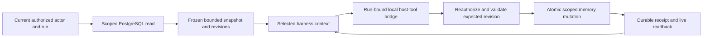

# Hermes-style persistent memory

> **Replaced 2026-11-02 by the unified memory** (see [operator-memory](operator-memory.md), "Unified memory"). The `memory` table and the `zetta:remember` block are gone. A bot's notes are memory items of type `solo` tagged `memory`, the person's profile is items of type `owner` tagged `profile`, and the same bounded blocks (1375 and 2200 characters) are built from them. This page stays as the record of the research.

Status: source-backed proposal, 2026-10-22. [054a](../../tasks/054a-record-hermes-memory-contract.md) records research before full runtime prerequisites. This does not complete RFC-054, authorize schema changes or claim Hermes is installed/connected. Source reads only; no private memory import, dependency install, model call or database migration. All upstream references accessed 2026-10-22.

## Motivation and constraints

A learns a preference with a shared specialist and expects it in a later conversation, regardless of harness. B can use the same specialist but must not receive A's preference. A personal chief may coordinate A's other bots without gaining B's knowledge or credentials. Restart must preserve accepted memory writes; a model saying “remembered” is insufficient.

Reuse Hermes's bounded curated-memory semantics through Zetta's actor-scoped durable service. Preserve [approved ownership](ownership.md), [execution isolation](execution-isolation.md) and [harness boundaries](harness-compatibility.md). Memories are information, not instructions that can grant access. Conversation history, curated memory, reusable instructions and secrets remain distinct stores and lifecycles.

## Exact upstream mechanism and license

The intended reference is **NousResearch/hermes-agent built-in curated memory**, not a hosted Hermes API or a specific external vector store. Research pinned upstream commit `41dfcf2c1bd7146d4ad46aea08b7dd007900602e` (2026-10-22). The repository's [pinned LICENSE](https://github.com/NousResearch/hermes-agent/blob/41dfcf2c1bd7146d4ad46aea08b7dd007900602e/LICENSE) is MIT, copyright2025 Nous Research; retain its notice if code is copied. The proposal below reimplements named semantics in TypeScript/PostgreSQL, with no Python package/service or upstream code copied in this task. Future copied code/assets require provenance and license notices at that change.

| Primary source at the pinned commit                                                                                                                       | Observed behavior                                                                                                                                                                                    |
| --------------------------------------------------------------------------------------------------------------------------------------------------------- | ---------------------------------------------------------------------------------------------------------------------------------------------------------------------------------------------------- |
| [`tools/memory_tool_store.py`](https://github.com/NousResearch/hermes-agent/blob/41dfcf2c1bd7146d4ad46aea08b7dd007900602e/tools/memory_tool_store.py)     | File-backed `MemoryStore`, frozen prompt snapshot, bounded writes, separate lock files, re-read under lock and atomic replace, drift/stale-entry errors, duplicate-add no-op, all-or-nothing batches |
| [`tools/memory_tool.py`](https://github.com/NousResearch/hermes-agent/blob/41dfcf2c1bd7146d4ad46aea08b7dd007900602e/tools/memory_tool.py)                 | Native `memory` tool with memory/user targets and add/patch/remove or operations batch; legacy replace rejected at public tool entry; JSON result/error and enabled-store gates                      |
| [`agent/memory_provider.py`](https://github.com/NousResearch/hermes-agent/blob/41dfcf2c1bd7146d4ad46aea08b7dd007900602e/agent/memory_provider.py)         | Provider lifecycle: initialize/static block/prefetch/sync/tool dispatch/session boundaries/shutdown; instances must retain home/identity binding and thread context                                  |
| [`agent/memory_manager.py`](https://github.com/NousResearch/hermes-agent/blob/41dfcf2c1bd7146d4ad46aea08b7dd007900602e/agent/memory_manager.py)           | Provider management, scoped background operations, finite drains/stuck-call handling and successful built-in write mirroring; not a Zetta service API                                                |
| [`tools/session_search_tool.py`](https://github.com/NousResearch/hermes-agent/blob/41dfcf2c1bd7146d4ad46aea08b7dd007900602e/tools/session_search_tool.py) | Separate history discovery/read/scroll/browse tool using FTS5/session lineage; curated memory is not the full transcript database                                                                    |

The [official overview](https://hermes-agent.nousresearch.com/docs/user-guide/features/memory) documents two files under a Hermes home: MEMORY.md (2,200 characters) and USER.md (1,375). Both enter the prompt as a session-start snapshot; writes persist without changing that prefix. Overflow returns an error rather than silent eviction. It explicitly warns against two agents sharing one Hermes home. Native profiles and the Python provider extension API are integration mechanisms, not an already-authorized multi-user Zetta backend.

Current source refines the overview: successful writes report completion, usage/count and sometimes changed-entry provenance, without automatically echoing the entire store. Error paths can return current candidates. Internal store `replace` and public tool acceptance differ; do not infer the public contract from internal methods.

## Options and decision

| Option                                                | Cost / trade-off                                                                                                    | Recommendation                              |
| ----------------------------------------------------- | ------------------------------------------------------------------------------------------------------------------- | ------------------------------------------- |
| Run Hermes memory files/Python per actor and bot      | Another runtime, process/home leases, file synchronization and callback integration for six harnesses               | Reject for initial Zetta implementation     |
| Add a Hermes external memory provider                 | Adds provider-specific credentials/egress, retrieval and retention semantics; no chosen provider currently required | Defer; no fictitious hosted Hermes endpoint |
| Port bounded curated semantics to existing PostgreSQL | Requires scoped transactions/revisions and a renderer; uses existing `pg`, Drizzle and Zod dependencies             | Select as proposal                          |

The port reuses curated stores, explicit add/patch/remove, bounded capacity, atomic batches, duplicate handling, immutable prompt snapshots and visible errors. It adds Zetta's immutable actor binding, stable entry IDs, optimistic revisions, provenance and deletion rules. Those additions are **local design**, not claims of upstream revision tokens or tenant ACLs. `packages/db/package.json` already declares pg/Drizzle/Zod; no vector database, embedding/model dependency or package change is proposed.

## Proposed scopes and bounded contract

| Namespace                      | Read/write authority                                                                   | Initial capacity                                                      |
| ------------------------------ | -------------------------------------------------------------------------------------- | --------------------------------------------------------------------- |
| User profile                   | Actor's own stable preferences; owner-authorized bots may read within that actor's run | 1,375 Unicode code points total                                       |
| Actor + bot curated notes      | Facts/corrections learned by that bot while working for that actor                     | 2,200 Unicode code points total                                       |
| Published reusable instruction | Separate explicit authorized publication/versioned configuration flow                  | No implicit memory-to-team promotion; limits belong to its owning RFC |

These are logical namespaces, not an approved SQL schema/API. A bot ID never substitutes for actor identity. Workspaces/groups are visual and never enter an access decision. Shared-bot owner/admin cannot read another actor's memories. Chief delegation preserves actor; delegated work may receive only the selected source memories authorized for that task, not a union of all bots' stores. Scheduled work reads the routine owner's namespaces. No team memory is created merely because a bot is team-visible.

Count Unicode code points, matching Python `len` semantics; count the three-code-point `\n§\n` delimiter between entries. Do not count prompt headers toward those content budgets. Do not use JavaScript UTF-16 `.length` or silently truncate/normalize user content. Bound each store to64 entries and each batch to16 operations initially; these extra limits are local proposals. No automatic eviction, summarization, silent consolidation or capacity increase on overflow.

Each mutation carries an invocation idempotency key, target scope derived from current actor/run/bot, expected store revision and stable entry IDs. `add` records source provenance; exact duplicate content within one store is a no-op. `patch` supplies the expected entry revision plus old/new span; zero/multiple matches, empty new span, no-op or stale entry fail visibly. `remove` targets the exact current entry. A bounded batch mutates one namespace atomically and validates the **final** budget, allowing “shorten/remove stale entry + add replacement” without an intermediate overflow. Cross-namespace changes use separately authorized operations, never an implicit multi-store batch.

Use a PostgreSQL transaction/row lock plus expected revisions; one winner increments the aggregate revision and entry revisions, a stale writer receives conflict with a bounded current authorized readback. Check quotas inside the same transaction. Caller retries must first read/resolve the conflict; never silently overwrite, fuzzy-merge or retry an unknown successful commit. A duplicate invocation returns its original bounded result. User-origin correction supersedes the old entry explicitly; recency alone or model confidence cannot overwrite a reviewed user fact.

Successful writes return durable receipt, current revision, changed entry IDs, capacity usage and bounded changed content where necessary. A tool may separately request a live authorized read; this does not modify its frozen prompt snapshot. Error categories include unavailable/unauthorized, invalid input, conflict, ambiguous span, overflow and persistence failure. No failure may return another actor's existence/content. Reusable instructions/configuration changes still follow exact-diff user approval; calling them memory does not bypass that rule.

## Snapshot and harness interoperability

Capture snapshot content/revisions once at the logical run's initial native context boundary and retain its immutable identity for attempts/reconnects. This maps Hermes session-start freezing to Zetta's durable runs. Writes become visible through tool results immediately and in the next new run snapshot; they do not rewrite an in-flight prefix. Resume/retry must use the recorded snapshot only while access and deletion leases remain valid. If a native resumed session contains a different actor/configuration/snapshot, start a fresh owned session instead of claiming its history was replaced. Restart does not imply a fresh snapshot or permission to replay side effects.

| Harness        | Snapshot / live-tool candidate                                                     | Native memory boundary to prove                                                                                                                       |
| -------------- | ---------------------------------------------------------------------------------- | ----------------------------------------------------------------------------------------------------------------------------------------------------- |
| Pi1.4.0        | Explicit initial instructions/context plus trusted registered Zetta extension tool | Private agent directory, no discovered global context/extensions/MCP; materialized approved inputs only                                               |
| Codex0.163.0   | App-server initial instructions plus dynamic host tools                            | Private CODEX_HOME/HOME, generated config and controlled memory/skill/hook roots; no host app daemon                                                  |
| OMP18.6.1      | Explicit initial context plus native host tools                                    | Private full native root/profile/XDG state, no .claude/.codex/.gemini or mnemopi/provider fallback                                                    |
| Claude2.1.233  | Explicit initial context plus strict selected stdio MCP                            | Private HOME/config/native login; disable uncontrolled auto-memory/discovery with version-evidenced settings, without disabling the needed MCP bridge |
| OpenCode2.0.28 | Owned session context plus private v2 local MCP                                    | Private server/DB/XDG/temp, explicit selected config/plugins/instructions; no background service or foreign session                                   |
| Cursor         | Explicit context plus local MCP is a documented candidate                          | Still blocked on verified product/version and complete private-state behavior                                                                         |

These paths come from the [six-harness research](harness-compatibility.md); none is a completed operational proof. Do not invent a universal memory-disable flag. A private native home prevents cross-user reads but does not by itself prevent a harness's own automatic memory from diverging from Zetta. Each adapter must prove that only the accepted snapshot and scoped live tools become durable memory sources. Actor-private native transcripts may contain snapshots; include them in retention/deletion accounting.

## Provenance, deletion and egress

Keep source actor/bot, conversation/message/run, origin (explicit user correction versus autonomous suggestion), timestamp, content/revision lineage and authorized source reference. The server derives those fields. Credentials, raw tokens, authentication screenshots and unnecessary personal data are rejected/redacted under the owning policy. Retrieved text is untrusted background; framing it is not an authorization or prompt-injection boundary. Explicit correction creates a new revision and supersedes the old value; there is no competing hidden native store.

Proposed lifecycle: retain active curated entries until owner removal/expiry; use no automatic expiry for ordinary stable preferences. Remove/expire immediately denies future retrieval and new snapshots, invalidates caches/secondary indexes and revokes affected active snapshot leases. Cancel or rebuild affected active native contexts before further dispatch; data already copied to a provider cannot be recalled. Immutable evidence means prior outcome identity/revisions remain truthful, not that deleted private content must remain exposed forever.

Retain only content-free tombstones/audit metadata needed for idempotency and correction provenance after deletion. Native transcripts, old snapshot payloads, database history/backups and external provider copies need explicit purge/retention rules; none is resolved by hiding a live row. Membership removal denies all reads/dispatch and suspends owned resources under existing policy. Final physical purge duration, backup expiry and historical evidence redaction remain **owner acceptance gates**; this research does not select a legal retention period.

The curated store itself needs no inference or external memory service. Injected content can still leave through whichever conversational harness/model processes the run. Additional Jev/Laya memory-ranking or consolidation calls would be new explicit egress and are not included in this initial port. Never import Codex's personal memory folder or any actor's existing Hermes/native home automatically.

## Synthetic lifecycle and verification gates

1. A/shared-bot starts snapshot revision7; B/same-bot reads B's empty private store. Moving either visual workspace changes neither scope.
2. A saves a preference through invocationX/expected7: commit8, durable receipt. Retrying X returns the same receipt; an unrelated writer expecting7 gets conflict. A's current prefix remains revision7; a live read sees8.
3. A starts a new run under any accepted harness after server restart: snapshot8 contains the preference. A's chief delegates only the authorized relevant entry; B/admin sees none of it.
4. A atomically replaces a stale fact at capacity; over-limit/multi-match/persistence-error batches leave the store unchanged. A user correction supersedes the prior fact without a parallel hidden memory.
5. A forgets the entry: later retrieval and snapshots exclude it, active snapshot leases are revoked, foreign IDs receive non-disclosing denial, and retained payload copies follow the approved purge policy.

Before implementation acceptance: approve logical scope/quotas/conflicts/deletion policy; complete RFC-002/005/006/007/009 as required by consumers; approve schema through RFC-055; implement meaningful A/B/admin/shared-bot/chief/schedule/restart/conflict/duplicate/overflow/purge tests on real disposable PostgreSQL. Prove a memory read/write and later-session recall through each actual harness bridge, including native-memory bypass attempts. Parent054 cannot be completed by a mocked store or by this proposal alone.

## Implemented in v1 (2026-10-23) — owner asked for Hermes-like behaviour

Verified against the upstream docs (memory feature page, MIT repo `NousResearch/hermes-agent`); semantics reimplemented on PostgreSQL, no Python or upstream code copied.

| Hermes behaviour                                                                         | Zetta v1                                                                                                                                                                         |
| ---------------------------------------------------------------------------------------- | -------------------------------------------------------------------------------------------------------------------------------------------------------------------------------- |
| Two bounded stores (MEMORY 2,200 / USER 1,375 chars, `§`-delimited)                      | `memory.target` = `memory` (that bot's own notes, per user) or `user` (profile shared by the user's bots); same limits, counted in Unicode code points, max 64 entries per store |
| `memory` tool: add / patch (unique span) / remove (unique substring), `operations` batch | `zetta:remember` block with `target`, `action`, `content`, `match`, or `operations[]` (max 16); no `replace`, no read action                                                     |
| Final-size budget check; full store errors with its entries, never auto-evicts           | `OVERFLOW` returns current entries and usage to the model in the tool result; "shorten + add" in one batch succeeds                                                              |
| Exact duplicate is a no-op success                                                       | Same (case/whitespace-insensitive)                                                                                                                                               |
| Ambiguous or missing match is rejected with candidates                                   | `AMBIGUOUS` / `NOT_FOUND` with entries                                                                                                                                           |
| Entries scanned for injection, exfiltration, invisible Unicode                           | Secret screen plus injection/exfiltration/invisible-character screen (`UNSAFE`)                                                                                                  |
| Frozen snapshot at session start; writes visible in tool results, in prompt next session | Snapshot stored per conversation and bot on first turn (`conversation.memory_snapshot`); header shows `% — used/limit chars`; writes appear in the next conversation             |
| Whole store injected (no retrieval ranking)                                              | Same; the old relevance filter was removed for memory (kept for reusable instructions)                                                                                           |
| Per-profile isolation (never share one home)                                             | Every query is scoped by owner; two-user test proves no cross-read; native harness homes stay private                                                                            |
| Save-vs-skip guidance in the prompt                                                      | Included in the tool preamble                                                                                                                                                    |
| Atomic batches, lock on write                                                            | One transaction with a per-store advisory lock; failure rolls back the whole batch                                                                                               |

Deliberately not in v1: `session_search` over past chats (FTS), background "nudge" reviews, external providers, optional `write_approval` staging (bot-written _instructions_ already need approval), `/journey` timeline. Native harness memory (e.g. Claude auto-memory, Codex memories) is still only isolated by per-user homes; per-harness disabling is unproven because the other five harnesses are quota-limited or missing (see release readiness).

Tests: `apps/server/src/modules/features/memory.integration.test.ts` (idempotent add, unique patch/remove, atomic rollback, overflow with entries, code-point counting, secret/injection refusal, per-user and per-bot privacy, rendered usage line).
