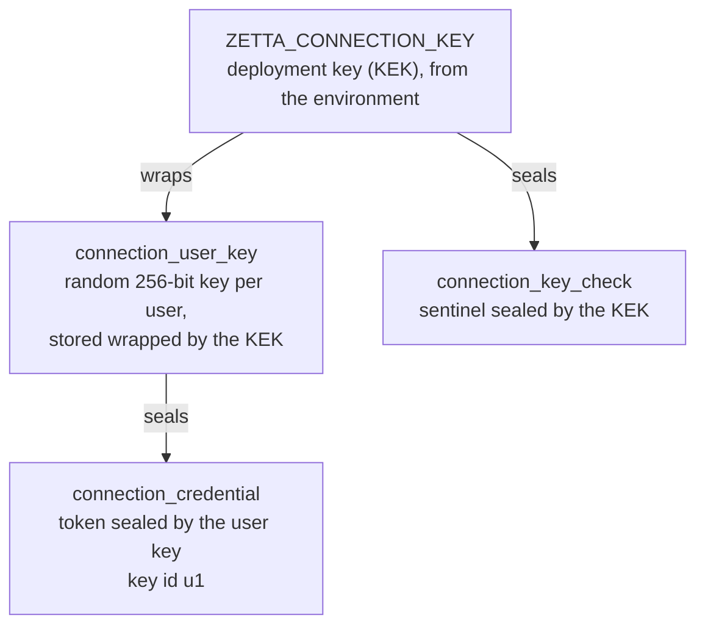
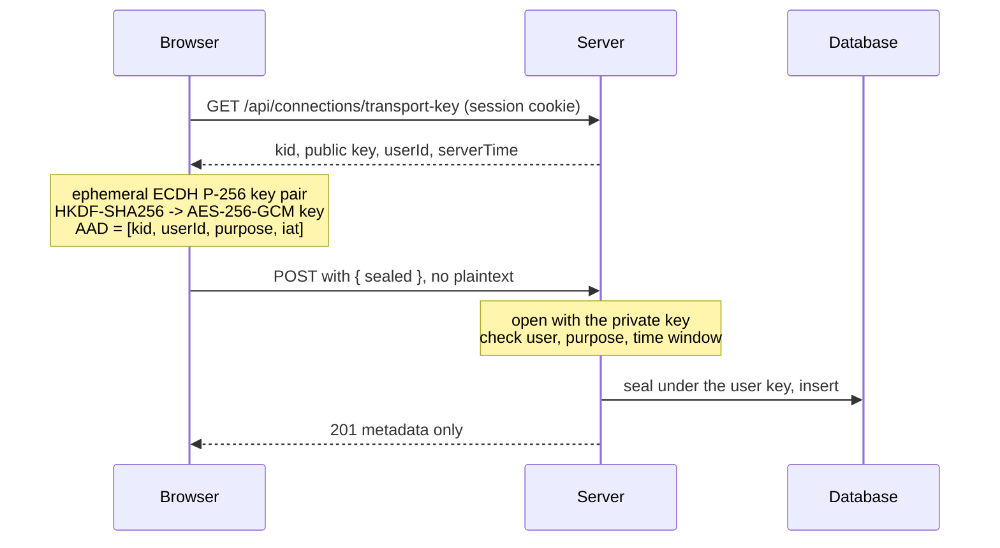

# How Zetta protects credentials

Status: implemented 2026-10-31. This document explains the full design: how a token goes from the browser to the database and back to a bot, which keys protect it, and what the design does not protect against. It extends the decision record [connection-secrets](../decisions/connection-secrets.md), which stays the source for the envelope format, the nonce ledger and the mutation receipts.

## What was wrong, and what changed

Before this change:

- Credentials were already encrypted at rest (AES-256-GCM in `connection_credential`). They were **not** plaintext in the database, and no route returned them to the browser.
- But **one key** (`ZETTA_CONNECTION_KEY`) encrypted the credentials of **every user**. One leaked key exposed everyone. You could not destroy one user's credentials. A key rotation had to decrypt and re-encrypt every credential. All credentials shared one budget of 1,000,000 encryptions.
- The browser sent the token as **plain JSON** inside TLS. TLS is optional in Zetta (`ZETTA_TLS_CERT` and `ZETTA_TLS_KEY`), and a proxy, an access log or a crash report could hold the raw token.

After this change:

1. **A key for each user.** Each user has a random 256-bit key. The deployment key wraps it. Credentials are encrypted with the user key.
2. **Sealed transport.** The browser encrypts the credential to a server key before it sends it. The three routes that accept a credential accept only sealed bodies.

## The reference: how Bitwarden does it

Bitwarden is a zero-knowledge vault. Its [security white paper](https://bitwarden.com/help/bitwarden-security-white-paper/) describes this chain:

1. The master password and the account email go through PBKDF2-SHA256 (600,000 iterations by default; Argon2id is an option). The result is the **Master Key**. It never leaves the client.
2. HKDF expands the Master Key to the **Stretched Master Key**.
3. At sign-up the client creates a random 512-bit **User Symmetric Key**. The Stretched Master Key encrypts it. The server stores this **Protected Symmetric Key** and cannot open it.
4. The User Symmetric Key encrypts a random key for each item. That key encrypts the item (AES-CBC-256 with HMAC).
5. The client sends a hash of the master password for sign-in. The server hashes it again with a random salt.
6. For organizations, an RSA key pair per user and an organization key (wrapped with RSA-OAEP) share items.
7. Bitwarden also encrypts sensitive columns in the database at the application level, with keys from a key management service, on top of disk encryption.

### What we copied and what we did not

| Bitwarden                                             | Zetta                                                                             | Why                                                                                                |
| ----------------------------------------------------- | --------------------------------------------------------------------------------- | -------------------------------------------------------------------------------------------------- |
| Random key for each user, stored only in wrapped form | `connection_user_key`: random 256-bit key, wrapped by the deployment key          | Same idea: a database leak shows no usable key.                                                    |
| Items encrypted with the user key                     | Credentials encrypted with the user key (key id `u1`)                             | Same hierarchy.                                                                                    |
| Authenticated encryption                              | AES-256-GCM with associated data that binds owner, connection, version and key id | GCM is built into `node:crypto`. No new dependency.                                                |
| Master Key from the master password, on the client    | Deployment key `ZETTA_CONNECTION_KEY`, on the server                              | **Different on purpose.** See below.                                                               |
| Server cannot decrypt (zero knowledge)                | Server can decrypt                                                                | **Different on purpose.** See below.                                                               |
| Encrypt in the client before upload                   | Sealed transport (ECDH P-256, HKDF, AES-256-GCM)                                  | The client encrypts to a server key. Bitwarden's client encrypts to a key the server never has.    |
| Key per item                                          | Not copied                                                                        | A credential is a single small secret. A second layer adds code and no new protection here.        |
| Organization keys with RSA                            | Not copied                                                                        | Team configuration keeps the secret under the admin who set it; members use it through the server. |

**Why not zero knowledge.** In Bitwarden only the signed-in user's client decrypts the vault, so a server compromise exposes nothing. A Zetta bot must use a credential when the user is **offline**: the scheduler, inbound Telegram and WhatsApp polling, routines and goal loops all run without the user. A key derived from a password the server never sees would make all of that stop. A password reset would also lose every credential. We took the part of Bitwarden's design that fits (a key hierarchy where the database holds only wrapped keys) and kept the server as the decrypting party. If you later want zero knowledge for some credentials, the user key is the place to do it: wrap it with a password-derived key instead of the deployment key, and accept that those credentials work only while the user is signed in.

## Key hierarchy

- The **deployment key** (KEK) is the only key in the environment. It wraps user keys and the key-check sentinel. It no longer touches credentials.
- A **user key** is created on a user's first credential. It lives in memory only while one request uses it, then the code overwrites it with zeros.
- A **credential** envelope has key id `u<keyVersion>` (now `u1`). The id `u<digits>` is reserved: the deployment key id (`ZETTA_CONNECTION_KEY_ID`, default `v1`) cannot look like it.

## Data model

| Table                         | Holds                                                                                    | Secret?                        |
| ----------------------------- | ---------------------------------------------------------------------------------------- | ------------------------------ |
| `connection`                  | Owner, provider, label, state, revision                                                  | No                             |
| `connection_credential`       | One envelope for each credential version                                                 | Ciphertext, under the user key |
| `connection_user_key`         | One wrapped user key for each user, `key_version`, `encryption_count`                    | Ciphertext, under the KEK      |
| `connection_key_check`        | One sentinel, `encryption_count` of the KEK                                              | Ciphertext, under the KEK      |
| `connection_nonce`            | Ledger of every nonce ever used, with a purpose: `credential`, `key-check` or `user-key` | No                             |
| `connection_mutation_receipt` | Idempotency receipts (an HMAC of the request)                                            | No                             |

Other tables (`mcp_server`, `bot_connection`, `source`) store only a `connection_id` reference.

### Envelope and associated data

Every envelope has the same shape: version 1, `aes-256-gcm`, key id, a 12-byte nonce, a 16-byte tag and 1 to 16,384 bytes of ciphertext. The associated data (AAD) is a fixed-position JSON array. A change to any field makes decryption fail.

| Purpose          | AAD                                                                                                             |
| ---------------- | --------------------------------------------------------------------------------------------------------------- |
| Credential       | `["zetta.connection", 1, keyId, ownerUserId, connectionId, "api-key", credentialVersion]` where `keyId` is `u1` |
| Wrapped user key | `["zetta.user-key", 1, kekId, ownerUserId, keyVersion]`                                                         |
| Key check        | `["zetta.connection-key-check", 1, kekId]`                                                                      |
| Transport        | `["zetta.transport", 1, kid, userId, purpose, iat]`                                                             |

Result: a ciphertext cannot move to another user, another connection or another version, and a wrapped user key cannot move to another user. The user key is stored as base64 text, so it passes through the same UTF-8 checked path as every other secret.

### Counters and limits

- Each user key counts the credentials it sealed (`connection_user_key.encryption_count`). At 1,000,000 it refuses new credentials (`key-capacity`). This is an operational safety limit, not a proven cryptographic bound.
- The KEK counts its own encryptions: the key check and one for each user key. At boot the number of ledger rows with the KEK key id must equal this counter, and every other ledger row must have a key id `u<n>`. A mismatch disables connections (fail closed).

## Transport: how a token reaches the server

How it works:

- `packages/core/src/sealed-transport.ts` has the primitive. It uses only Web Crypto, so the same code runs in the browser and in Bun. There is no new dependency.
- The server keeps a transport key pair in memory (`apps/server/src/modules/connections/transport.ts`). The private key is **non-extractable**: code in the process can use it but cannot read it out. The key rotates every hour. The previous key stays valid for 5 minutes after it expires, so a request in flight does not fail. A restart retires all keys.
- The browser fetches the key **for every send**. Sealing is rare, so one extra request is cheap, and it avoids a stale cache, a user switch and clock skew. The payload is stamped with the **server's** clock (`serverTime`). The server accepts a payload that is at most 5 minutes old and at most 1 minute in the future.
- The AAD holds the user id and a **purpose** string, so a sealed body cannot be replayed for another user or another route.
- If the key rotated between the fetch and the request, the server answers `409 TRANSPORT_KEY_EXPIRED` and the browser tries once more.
- If the page has no `crypto.subtle` (not a secure context), the browser shows an error. It **never** falls back to plaintext.
- Limits: a sealed payload is at most 64 KiB. When the key id is known, every failure to open gives one fixed error (`400`), so the response shows nothing about why it failed. An unknown or retired key id is the one visible case (`409`), because the client needs to know it must fetch a new key.

### Routes

| Route                                | Body                                                     | Purpose in the AAD             |
| ------------------------------------ | -------------------------------------------------------- | ------------------------------ |
| `GET /api/connections/transport-key` | none                                                     | not applicable                 |
| `POST /api/plugins`                  | `{ id, sealed, botIds }`, `sealed` opens to `{ config }` | `plugin.install:<id>`          |
| `PUT /api/plugins/:id/config`        | `{ sealed }`, opens to `{ config }`                      | `plugin.configure:<id>`        |
| `POST /api/connections`              | `{ provider, label, sealed }`, opens to `{ secret }`     | `connection.create:<provider>` |

A request with a plaintext `config` or `secret` fails the strict schema and gets `400 INVALID_REQUEST`. An unknown or retired key gets `409 TRANSPORT_KEY_EXPIRED`. The same limits that applied to the plaintext body apply to the opened payload. `/api/mcp` is a different surface and did not change.

## Lifecycle

**First credential for a user.** In one transaction, under the user's membership lock: create 32 random bytes, wrap them with the KEK, reserve the nonce in the ledger, insert `connection_user_key`, add 1 to the KEK counter. Then seal the credential with the user key.

**Use by a bot.** `resolveForExecution` checks that the user is an active member, reads the connection, reads and unwraps the user key, opens the credential and returns the bytes. The caller zeroes them after use. A missing user key, a wrong key or a changed envelope all fail the same way (`unavailable`). Revoked, expired and foreign connections fail as `not-found`.

**Existing data (backfill).** Credentials written before this change are sealed under the KEK. At boot, inside the same advisory-locked transaction as the integrity check, the store finds every row sealed under the KEK, opens it, seals it under the owner's user key (creating the key if needed), reserves a new nonce and updates the row. It covers **every version**, including old ones. The old nonce stays in the ledger as a tombstone. The step is idempotent: a second boot finds nothing to do. If any step fails, the whole transaction rolls back, nothing is lost, and connections stay disabled until the cause is fixed.

**Rotating a user key (implemented).** `store.rotateUserKey(userId)` is for trusted callers only; no route reaches it. In one transaction, under the user's membership lock, it creates a new random key (`key_version` + 1, key id `u<n+1>`), opens every credential of the user (all versions) with the old key, seals each one with the new key, wraps the new key with the KEK and updates the user's single `connection_user_key` row in place. Reads and writes for that user wait on the lock, so nobody sees a half-rotated user. If one credential does not open under the current key, the whole rotation aborts and nothing changes. The operator runs it with `bun run connections:rotate-user-key <userId>` or `--all` from `apps/server`; it prints counts only. Each rotation adds 1 to the KEK counter and resets the user's counter to the number of credentials re-sealed.

**Deleting a user's connection data (implemented, no caller yet).** `store.purgeOwner(userId)` is for trusted callers only. In one transaction it deletes the user key first (the crypto-shred: from this point the credentials cannot be read), then the idempotency receipts, the credential rows and the `connection` rows. The nonce ledger keeps its tombstones; they hold no personal data. `connectionsService.purgeOwner(userId)` first removes the user's `bot_connection` rows, because that reference is `RESTRICT`; `mcp_server` and `source` references are set to null by the database. The app has no user-deletion flow yet, so nothing calls it. The flow that is added later must also delete the user's audit events and the rest of the user's rows before it deletes the `user` row.

**Crypto-shred by hand.** Deleting one user's `connection_user_key` row alone also makes that user's credentials unreadable. Other users are not affected, and the `connection` rows remain as metadata.

**Rotating the deployment key (not implemented).** The boot check accepts ledger rows only under the configured key id and under `u<n>`, so a new key id needs a place to record the retired one. A future change must:

- add a column on `connection_key_check` for retired key ids and relax the boot check for those ids only;
- create a new key check under the new key and unwrap and re-wrap every user key (no credential changes);
- accept that request MACs (idempotency receipts) derive from the KEK, so old receipts can no longer be verified; they only protect against replays.

## Threat model

Assets: the user's tokens (LLM API keys, GitHub, Telegram, Google OAuth, password-manager service accounts, mailbox passwords). Trust boundaries: browser to server, server to database, server to the bot's process.

| Threat                 | Scenario                                                 | Control                                                                                                                                                                                                                                                                                                                                                                        | Status                                                     |
| ---------------------- | -------------------------------------------------------- | ------------------------------------------------------------------------------------------------------------------------------------------------------------------------------------------------------------------------------------------------------------------------------------------------------------------------------------------------------------------------------ | ---------------------------------------------------------- |
| Information disclosure | Database dump or backup leaks                            | Credentials and user keys are ciphertext; the key is not in the database                                                                                                                                                                                                                                                                                                       | Covered                                                    |
| Information disclosure | One user key leaks                                       | Only that user's credentials                                                                                                                                                                                                                                                                                                                                                   | Covered (before: all users)                                |
| Information disclosure | Proxy, access log or crash report holds the request body | The body is sealed                                                                                                                                                                                                                                                                                                                                                             | Covered inside TLS and without it, against passive capture |
| Information disclosure | Response or error leaks a secret                         | Responses carry metadata only; fixed errors; `no-store`                                                                                                                                                                                                                                                                                                                        | Covered, tested                                            |
| Tampering              | Move a ciphertext to another user or connection          | AAD binds owner, connection, version, key id                                                                                                                                                                                                                                                                                                                                   | Covered, tested                                            |
| Tampering              | Replay a sealed body for another user or route           | AAD binds user and purpose; 5-minute window                                                                                                                                                                                                                                                                                                                                    | Covered, tested                                            |
| Spoofing               | Use someone else's connection                            | Owner check and active membership in the same transaction                                                                                                                                                                                                                                                                                                                      | Covered (unchanged)                                        |
| Denial of service      | Large sealed body                                        | 64 KiB cap, validation before any crypto                                                                                                                                                                                                                                                                                                                                       | Covered                                                    |
| Elevation              | Key id confusion between the KEK and user keys           | `u<digits>` reserved; each decrypt path checks the exact key id                                                                                                                                                                                                                                                                                                                | Covered, tested                                            |
| Repudiation            | Who created, replaced or read a credential               | Audit events (kind `connection`): `created`, `revoked`, `key_created`, `key_rotated`, `purged` and `used` (a run read the credential, with bot and connection). `key_created`, `key_rotated` and `purged` are written inside the transaction of the change; `created`, `revoked` and `used` are best-effort writes by the service. Plugin tool calls are audited as tool calls | Covered, except reads by plugin polling (by design)        |

## What this design does not protect against

Be clear about these limits.

- **A compromised running server.** The server holds the KEK in its environment and decrypts credentials to use them. An attacker who can run code in the server, or read its environment **and** the database, can read every credential. Bitwarden's zero-knowledge model does not have this weakness; Zetta cannot, because bots work while the user is offline.
- **An attacker with the database and the KEK.** Same result. Keep the KEK in restricted secret management, apart from backups.
- **An active man in the middle on plain HTTP.** An attacker who can change the response of `GET /api/connections/transport-key` can substitute their own public key. Sealed transport protects against passive capture and against logs. It does not replace TLS. Use HTTPS outside localhost.
- **Script in the page.** Cross-site scripting, or a malicious browser extension, can read the token from the form before it is sealed.
- **The token in use.** When a bot runs, the plaintext token is in server memory and, for CLI harnesses, in the child process environment. A bot with that access can keep the token. Rotate the provider token if you suspect this.
- **Several server processes.** The transport key pair lives in one process. With a load balancer and several instances, a sealed body can reach an instance that did not publish the key and get `409`. Zetta runs as one server today. A multi-instance deployment needs sticky routing or a shared key.
- **Rollback to an older server version.** The older boot check expects every ledger row to use the deployment key id, so it disables connections once user-key rows exist. Back up the database before the first start of this version, and plan to roll forward.
- **A rolling deploy.** An older instance that writes a credential under the KEK while a newer one runs gets that credential refused (`unavailable`) until the next boot moves it.

## Other secrets, outside this scope

- VM bearer tokens and VNC passwords are written as plaintext files with mode 0644 under `ZETTA_VM_TOKEN_ROOT` (the directory is 0700).
- Better-auth tables (`session.token`, `account.password` hash, `jwks.private_key`) follow better-auth defaults.
- There are no global security headers (CSP, HSTS) and TLS is optional.

## Operations

- **Back up the KEK separately from the database.** A database backup without the key cannot recover credentials. Losing the key means users reconnect their accounts; no one can decrypt for them.
- **Back up the database before the first start of this version.** The boot backfill changes every stored credential once.
- **Back up the database before a user-key rotation.** It rewrites the credentials of the users it touches. Rotate one user first and check the result before you use `--all`.
- Keep `ZETTA_CONNECTION_KEY_ID` stable. A different id with the same key bytes fails the boot check.
- Never log a request body on the three routes above, even sealed, and never log the opened payload.

## Where the code is

| Part                                     | Path                                                                                                                                                                                    |
| ---------------------------------------- | --------------------------------------------------------------------------------------------------------------------------------------------------------------------------------------- |
| Sealed transport primitive and its tests | `packages/core/src/sealed-transport.ts`, `packages/core/src/sealed-transport.test.ts`                                                                                                   |
| Server key ring                          | `apps/server/src/modules/connections/transport.ts`                                                                                                                                      |
| Wrap, unwrap and seal with the user key  | `apps/server/src/modules/connections/crypto.ts`                                                                                                                                         |
| User key creation, backfill, resolve     | `apps/server/src/modules/connections/store.ts`                                                                                                                                          |
| Sealed routes                            | `apps/server/src/modules/connections/routes.ts`, `apps/server/src/modules/integrations/routes.ts`                                                                                       |
| Browser sender                           | `apps/web/src/features/chat/sealed-send.ts`, `apps/web/src/features/plugins/plugins-api.ts`                                                                                             |
| Schema and migration                     | `packages/db/src/schema/connections.ts`, `packages/db/src/migrations/*_user_keys/`                                                                                                      |
| User key rotation script                 | `apps/server/src/scripts/rotate-user-key.ts` (`bun run connections:rotate-user-key`)                                                                                                    |
| Rotation, purge, audit                   | `rotateUserKey` and `purgeOwner` in `store.ts`; `purgeOwner` and the `used` event in `service.ts`                                                                                       |
| Tests that need a database               | `apps/server/src/modules/connections/connections.user-keys.integration.test.ts` and the route tests in `connections.service.integration.test.ts` and `integrations.integration.test.ts` |

## How we checked it

- The unit tests cover the primitive (tamper, wrong user, wrong purpose, time window, size) and the key ring (rotation, grace, concurrent first request).
- The database tests run against a real PostgreSQL and cover the user key per user, a user key copied onto another user, crypto-shred, the backfill and its second run, and the per-user limit.
- They also cover rotation (new key version, same secrets, other users untouched, repeated rotation, abort when one credential is corrupt), purge (everything of one user gone, others untouched, a second purge does nothing, bot bindings removed) and the audit events.
- We checked that the tests can fail: removing the owner from the wrap AAD fails a unit test, and skipping the backfill fails the database test.
- The database tests only run when `ZETTA_CHAT_TEST_DATABASE_URL` points to a database named `zetta_test`. Use a disposable database.

## Next steps

1. Deployment-key rotation (needs the retired key id column described above).
2. A user-deletion flow that calls `purgeOwner` (today `connection.owner_user_id` is `ON DELETE RESTRICT`, so a user with connections cannot be deleted until it does).
3. A shared transport key if Zetta runs more than one server process.
4. Move VM tokens and VNC passwords into the connections store.
